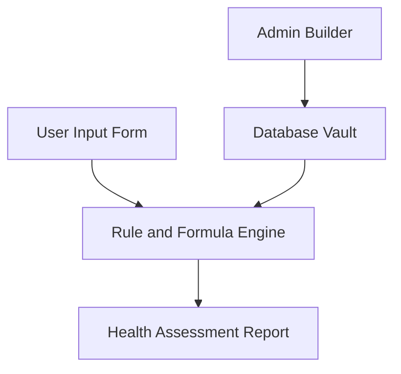

# System Architecture Overview

> **Non-Technical Guide**  
> *A plain-English explanation of the reusable health calculator platform.*

---

## 1. Core Concept

The platform is designed as a single reusable engine. Instead of writing custom software code for every new health test, the system reads a structured configuration document. Adding a new calculator (such as Niro CWS or COVID Risk) requires creating a configuration file, not writing new code.

---

## 2. System Flow Diagram

---

## 3. The Four Key Components

### 1. User Interface
- Renders questions, options, and unit selectors dynamically from the configuration.
- Displays calculated scores, risk categories, domain breakdowns, and recommendations.
- Adapts automatically whenever a calculator configuration is updated.

### 2. Admin Builder
- Provides a visual interface for non-technical team members to create and edit calculators.
- Allows configuring parameters, unit conversions, scoring bands, and display layouts.
- Includes a validator to check for errors before publishing.

### 3. Rule and Formula Engine
- Evaluates user inputs through a deterministic calculation pipeline.
- Normalizes units, computes derived values, scores parameter bands, and ranks risk contributors.
- Operates independently of specific calculator logic to ensure complete reusability.

### 4. Database Vault
- Stores standard biomarker definitions, calculator configurations, and assessment history.
- Maintains version control so every published result can be recreated accurately.
- Ensures data integrity and security.

---

## 4. Key System Benefits

- **Zero-Code Expansion:** New calculators are added by creating configuration data rather than editing core code.
- **Fast Evaluation:** Calculates results in under 0.3 seconds.
- **Full Traceability:** Every score traces directly to verified reference logic.
